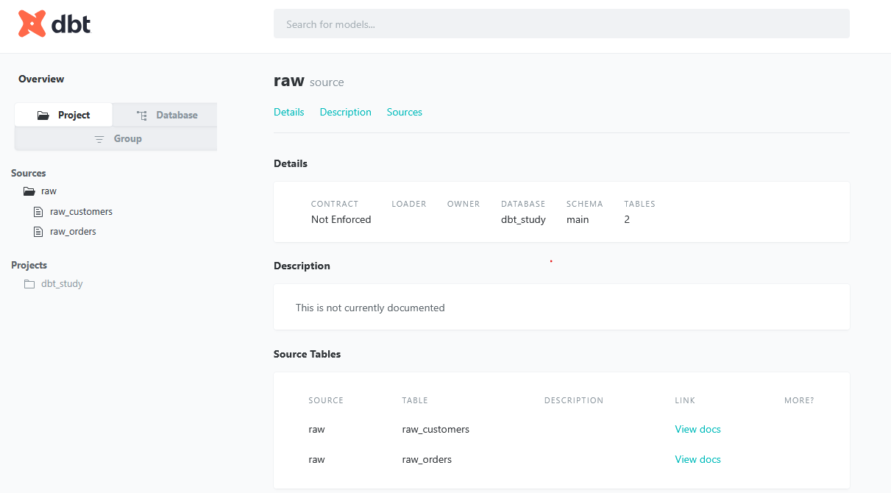
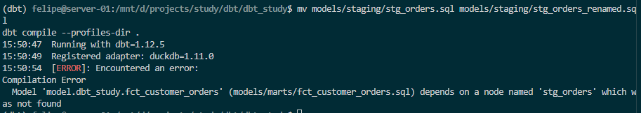

Welcome to your new dbt project!

### Using the starter project

Try running the following commands:
- dbt run
- dbt test


### Resources:
- Learn more about dbt [in the docs](https://docs.getdbt.com/docs/introduction)
- Check out [Discourse](https://discourse.getdbt.com/) for commonly asked questions and answers
- Join the [chat](https://community.getdbt.com/) on Slack for live discussions and support
- Find [dbt events](https://events.getdbt.com) near you
- Check out [the blog](https://blog.getdbt.com/) for the latest news on dbt's development and best practices

### Start
- Start env with 
```
python -m vevn dbt_study && cd dbt_study
```

- Install ibs
```
pip install dbt-duckdb pandas
```

Created seed data with

- seeds/raw_orders.csv
```
cat > seeds/raw_orders.csv << 'EOF'
id,customer_id,status,amount_cents,ordered_at
101,1,completed,2500,2024-03-01 10:15:00
102,1,completed,4200,2024-03-02 09:00:00
103,2,returned,1800,2024-03-02 14:30:00
104,3,completed,9900,2024-03-03 11:45:00
105,2,completed,3100,2024-03-04 16:20:00
106,4,pending,1500,2024-03-04 18:05:00
107,3,completed,2750,2024-03-05 08:10:00
EOF
```

- seeds/raw_customers.csv
```
cat > seeds/raw_customers.csv << 'EOF'
id,first_name,last_name,email,created_at
1,Ana,Silva,ana@example.com,2024-01-05
2,Bram,de Vries,bram@example.com,2024-01-12
3,Chloe,Jansen,chloe@example.com,2024-02-01
4,Dev,Patel,dev@example.com,2024-02-15
EOF
```

- Loaded up CSV data with
```
dbt seed --profiles-dir .
```

- Created the profiles.yml
```
cat > profiles.yml << 'EOF'
dbt_study:
  target: dev
  outputs:
    dev:
      type: duckdb
      path: dbt_study.duckdb
      threads: 4
EOF
```

- Check that the duckdb landed csv
```
python -c "import duckdb; print(duckdb.connect('dbt_study.duckdb').sql('show tables').df())"
```

- Add some sources, as dbt uses it as references to external outputs (like external tables in Databricks, a pointer to a table managed outside the platform)
```
mkdir -p models/staging models/marts
cat > models/staging/_sources.yml << 'EOF'
version: 2

sources:
  - name: raw
    schema: main
    tables:
      - name: raw_customers
      - name: raw_orders
EOF
```

Staging here has a purpose of distinguishing what a source system provided, and all the transformations made inside DBT, so it has the start point

- Create the staging model, it's similar to the silver layer in medallion architecture
```
cat > models/staging/stg_customers.sql << 'EOF'
select
    id as customer_id,
    first_name,
    last_name,
    lower(email) as email,
    cast(created_at as date) as created_at
from {{ source('raw', 'raw_customers') }}
EOF

cat > models/staging/stg_orders.sql << 'EOF'
select
    id as order_id,
    customer_id,
    status,
    amount_cents / 100.0 as amount,
    cast(ordered_at as timestamp) as ordered_at
from {{ source('raw', 'raw_orders') }}
EOF
```

Next come ***marts***, which are the analytics layers, where business logic live, using the staging data to be able to define metrics, dimensions and facts.

All references in DBT are made through the models, in this sense, its the ***{{ ref }}*** macro in Jinja templates, so it constructs the DAG based on the references (wheter materialized or not) on top of them.

Materialization configs constructs what will be physically stored or not, for instance, views / stagings will have no storage and marts as tables will, so it can be consumed in BI tooling for example.

- Creating the dims and facts
```
cat > models/marts/dim_customers.sql << 'EOF'
select
    customer_id,
    first_name || ' ' || last_name as full_name,
    email,
    created_at
from {{ ref('stg_customers') }}
EOF

cat > models/marts/fct_customer_orders.sql << 'EOF'
with orders as (
    select * from {{ ref('stg_orders') }}
),

customers as (
    select * from {{ ref('dim_customers') }}
)

select
    c.customer_id,
    c.full_name,
    count(o.order_id) as total_orders,
    sum(case when o.status = 'completed' then o.amount else 0 end) as completed_revenue,
    min(o.ordered_at) as first_order_at
from customers c
left join orders o using (customer_id)
group by 1, 2
EOF
```

In ***dbt_study.yml*** the materialization for each step is determined, a ***+*** will define a standard for each folder.

```
dbt run
```

this will do 5 things, parse the project, construct the DAG, compile the Jinja templating to SQL, wrap models into DDLs according to the materialization and execute against the compute.
The steps can be seen against the
```
/target
```
folder, where DBT produces the output files

You can generate / preview docs with
```
dbt docs generate --profiles-dir .
dbt docs serve --profiles-dir .
```

and will serve it at
```
http://localhost:8080
```

with a lot of the metadata beeing provided from the DAG, models, column descriptions and so on



From the chat history with [Claude](https://claude.ai/share/837babdf-58ba-48b5-a459-d67e1996a4bf)

Will answer the following

Checkpoints
1. What is the difference between source() and ref(), and what does each give you in the lineage graph?
- source() is about external to the DBT, what a system produces externally, ref() is used when already inside the DBT env / definitions. First will be the entry point in the DAG definition, the starting point for everything downwards, ref will construct on top of that, so the dependencies between the inputs get downstream
2. What did dbt add in target/run/...dim_customers.sql that you didn’t write?
- It compiles the Jinja templates to be able to generate the references from the sources and macros we defined in the code. For instance ***{{ ref }}*** will be transformed into the inputs (could be a sorce() from the external tables) and will define the DDL accordingly, example from our code, the seeds are source from CSV files, and the staging models define ***{{ source(raw_customers) }}, that will be transformed into "dbt_study.main.raw_customers" from the duckdb compute "main" schema
3. Why are staging models views and marts tables? When would you change that?
- Staging models would define my intermediate layer, as to clean up the data and get a sense from the sources into my "internal" naming pattern and governance nomenclature, let's say we have "id" column from customer data, and that would be defined as "customer_id" to maitain consistency downwards on the models.
- Marts define logic that the business requires and sees as applied to be metrified, that is, whatever the inputs (after clean up) can be considered relevant metrics / dimensions / facts for the business to aggregate on
4. If you rename stg_orders but not fct_customer_orders, what happens, and at what stage does dbt catch it?
- DBT has ***dbt test*** and ***dbt run** to check consistency accross the whole project, let's say in this case, my reference is gone, ***dbt test*** would catch it by determining a corrupt reference in ***fct_customer_orders***, and wouldn't be able to compile it, ***dbt run*** on the other hand would also do checks, but it would run against the compute, computing the steps before the error occurred
5. What does dbt run do beyond dbt compile?
- It computes the transformations (or models named in DBT) against the compute being run (in my example, duckdb). It also materializes the defined tables / view that are going to be needed as references for posterior steps and will consolidate the whole project.

Corrections on Claude Side
Q1: Correct
Q2: Mostly correct, having:
```
A small correction on my side: DuckDB names the database after the file (path: shop.duckdb), so the compiled reference is "shop"."main"."raw_customers", not dbt_study.main.... I wrote shop earlier for the same reason.
```
Q3: Mostly correct, having:
```
The reasoning here is about cost and freshness:

View: no storage, always fresh, but the query reruns every time someone reads it. That’s fine for a cheap rename and cast.
Table: computed once at build time, so reads are fast. The trade-off is that it’s stale until the next run, and you pay for storage and build compute.

When to change it:

A staging view gets slow, or many models stack on it: make it a table or incremental.
A mart is small and must always be fresh: make it a view.
A mart is huge: make it incremental.
```
Q4: incorrect
```
A broken ref() is caught at parse time, before anything touches the database. Any command that loads the project (run, build, compile, even dbt ls) fails immediately with a compilation error along the lines of “Model fct_customer_orders depends on a node named stg_orders which was not found.” Nothing runs, so nothing is partially built.
```

Tried it with
```
mv models/staging/stg_orders.sql models/staging/stg_orders_renamed.sql
dbt compile --profiles-dir .
```



Q5: correct