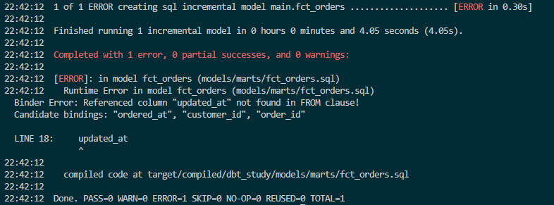
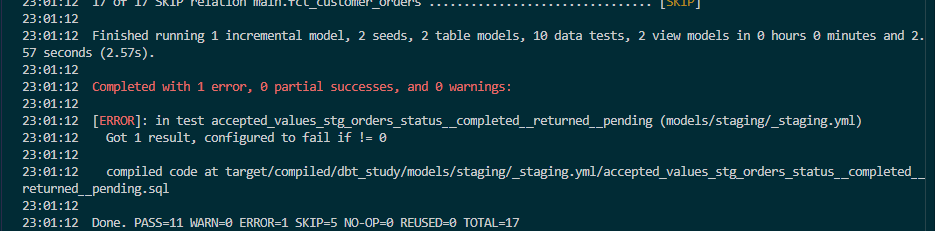

### Start

1. Updated seeds/raw_orders.csv with
```
cat > seeds/raw_orders.csv << 'EOF'
id,customer_id,status,amount_cents,ordered_at,updated_at
101,1,completed,2500,2024-03-01 10:15:00,2024-03-01 10:15:00
102,1,completed,4200,2024-03-02 09:00:00,2024-03-02 09:00:00
103,2,returned,1800,2024-03-02 14:30:00,2024-03-02 14:30:00
104,3,completed,9900,2024-03-03 11:45:00,2024-03-03 11:45:00
105,2,completed,3100,2024-03-04 16:20:00,2024-03-04 16:20:00
106,4,pending,1500,2024-03-04 18:05:00,2024-03-04 18:05:00
107,3,completed,2750,2024-03-05 08:10:00,2024-03-05 08:10:00
EOF
dbt seed --full-refresh --profiles-dir .
```

Needed ***--full-refresh*** on seeds, since plain ***dbt seed*** truncates and doesn't create new columns.

2. Carrying the watermark to staging, since it needs to be carried downstream to the incremental models
```
cat > models/staging/stg_orders.sql << 'EOF'
select
    id as order_id,
    customer_id,
    status,
    amount_cents / 100.0 as amount,
    cast(ordered_at as timestamp) as ordered_at,
    cast(updated_at as timestamp) as updated_at
from {{ source('raw', 'raw_orders') }}
EOF
```

3. Update the logic for the model to be incremental
```
cat > models/marts/fct_orders.sql << 'EOF'
{{ config(
    materialized='incremental',
    unique_key='order_id',
    incremental_strategy='delete+insert'
) }}

select
    order_id,
    customer_id,
    status,
    amount,
    ordered_at,
    updated_at
from {{ ref('stg_orders') }}


where updated_at > (select max(updated_at) from {{ this }})

EOF
```

So what happens here on first run, the incremental table loads all the records, and posterior runs add a capacity to merge on the provided key, given the field incremental strategy, delete + insert in this case

Running it again with 
```
dbt run --select fct_orders --profiles-dir .
```

While changing things, this error appeared



Checking data
```
python -c "import duckdb; print(duckdb.connect('dbt_study.duckdb').sql('select * from fct_orders order by order_id').df())"
```

Updating the seed
```
cat > seeds/raw_orders.csv << 'EOF'
id,customer_id,status,amount_cents,ordered_at,updated_at
101,1,completed,2500,2024-03-01 10:15:00,2024-03-01 10:15:00
102,1,completed,4200,2024-03-02 09:00:00,2024-03-02 09:00:00
103,2,returned,1800,2024-03-02 14:30:00,2024-03-02 14:30:00
104,3,completed,9900,2024-03-03 11:45:00,2024-03-03 11:45:00
105,2,completed,3100,2024-03-04 16:20:00,2024-03-04 16:20:00
106,4,completed,1500,2024-03-04 18:05:00,2024-03-07 08:00:00
107,3,completed,2750,2024-03-05 08:10:00,2024-03-05 08:10:00
108,1,completed,5000,2024-03-06 09:30:00,2024-03-06 09:30:00
109,4,completed,1200,2024-03-06 12:00:00,2024-03-06 12:00:00
EOF
```

and running it
```
dbt seed --profiles-dir .
dbt run --select fct_orders --profiles-dir .
```

and checking data again

```
python -c "import duckdb; print(duckdb.connect('dbt_study.duckdb').sql('select * from fct_orders order by order_id').df())"
```

If drift appears in the data, incremental models can be backfilled with full-refresh 
```
dbt run --select fct_orders --full-refresh --profiles-dir .
```

DBT has tests that go after the data, not the code, so it runs SQL queries for whatever logic we define, using yaml file to define metrics or defaults

Created with 
```
cat > models/staging/_staging.yml << 'EOF'
version: 2

models:
  - name: stg_customers
    columns:
      - name: customer_id
        data_tests:
          - unique
          - not_null

  - name: stg_orders
    columns:
      - name: order_id
        data_tests:
          - unique
          - not_null
      - name: customer_id
        data_tests:
          - not_null
          - relationships:
              to: ref('stg_customers')
              field: customer_id
      - name: status
        data_tests:
          - accepted_values:
              values: ['completed', 'returned', 'pending']
EOF

cat > models/marts/_marts.yml << 'EOF'
version: 2

models:
  - name: fct_orders
    columns:
      - name: order_id
        data_tests:
          - unique
          - not_null
EOF

cat > tests/assert_amount_non_negative.sql << 'EOF'
select order_id, amount
from {{ ref('fct_orders') }}
where amount < 0
EOF
```

and run with 
```
dbt test --profiles-dir .
```

To test out faulty data, incorrect row will be added with 
```
echo "110,2,refunded,900,2024-03-08 10:00:00,2024-03-08 10:00:00" >> seeds/raw_orders.csv
dbt seed --profiles-dir .
dbt build --profiles-dir .
```

Erroring out to

