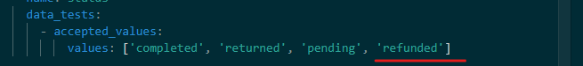
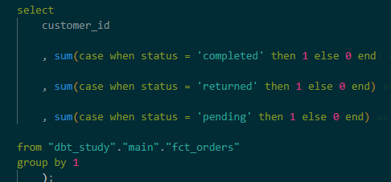
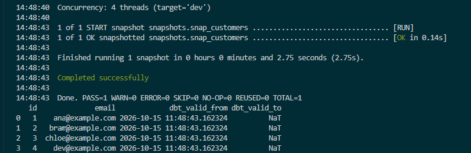
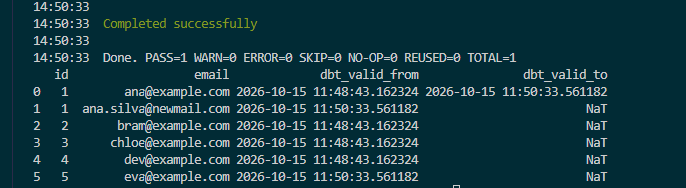

## Start

It'll start with macros, seeds, snapshots and packages.

- Macros are defined to remove repeated code, since they can be defined once and reused throughout the models.
- Seeds are small reference data to be added in the lake
- Snapshots are the incremental part where every version / run are kept, not just the current state

### First macro
Macros are defined as Jinja templates and are under the ***/macros*** folder, taking arguments and returning text, which dbt changes when it compiles the SQLs, so the compute never sees the macro, just the compiled SQLs.

### Added the acceptance test to be able to accept refunds in the seed data



For the macro the distinction is
- ***{{ ... }}*** outputs a value.
- ****** runs a statement (loops, ifs, macro definitions).
- ***{# ... #}*** is a comment.

### Macro creation
```
cat > macros/cents_to_currency.sql << 'EOF'

    round({{ column_name }} / 100.0, {{ precision }})

EOF

cat > models/staging/stg_orders.sql << 'EOF'
select
    id as order_id,
    customer_id,
    status,
    {{ cents_to_currency('amount_cents') }} as amount,
    cast(ordered_at as timestamp) as ordered_at,
    cast(updated_at as timestamp) as updated_at
from {{ source('raw', 'raw_orders') }}
EOF

dbt compile --select stg_orders --profiles-dir .
cat target/compiled/dbt_study/models/staging/stg_orders.sql
```

after running the compile
```
dbt compile --select stg_orders --profiles-dir .
```

the target file
```
cat target/compiled/dbt_study/models/staging/stg_orders.sql
```

will show the macro expansion from Jinja
```

    round({{ column_name }} / 100.0, {{ precision }})

```

to
```
round(amount_cents / 100.0, 2)
```

Macros can contain loops inside it with 
```
{{ % for % }}
```

example
```


select
    customer_id
    
    , sum(case when status = '{{ s }}' then 1 else 0 end) as {{ s }}_orders
    
from {{ ref('fct_orders') }}
group by 1
EOF

```

getting compiled to



## Packages
Similar to a ***requirements.txt*** fro python modules, the dbt package can be have shared macros, tests and models, packages in the ***packages.yaml*** file.

This lets cross-database portability, since the package can 

example 
```
cat > packages.yml << 'EOF'
packages:
  - package: dbt-labs/dbt_utils
    version: [">=1.3.0", "<2.0.0"]
EOF
dbt deps --profiles-dir .
```

And the package in this case provides a surrogate_key function, which can be used here

```
cat > models/marts/dim_customers.sql << 'EOF'
select
    {{ dbt_utils.generate_surrogate_key(['customer_id']) }} as customer_key,
    customer_id,
    first_name || ' ' || last_name as full_name,
    email,
    created_at
from {{ ref('stg_customers') }}
EOF

cat > models/marts/_marts.yml << 'EOF'
version: 2

models:
  - name: fct_orders
    columns:
      - name: order_id
        data_tests:
          - unique
          - not_null
      - name: amount
        data_tests:
          - dbt_utils.accepted_range:
              min_value: 0

  - name: dim_customers
    columns:
      - name: customer_key
        data_tests:
          - unique
          - not_null
EOF

rm tests/assert_amount_non_negative.sql
dbt build --profiles-dir . --select dim_customers fct_orders
```

Added seed for process status mapping, and updated the fact table that uses it that was previously hardcoded
```
cat > seeds/order_status_map.csv << 'EOF'
status,revenue_flag
completed,1
returned,0
pending,0
EOF

cat > models/marts/fct_customer_orders.sql << 'EOF'
with orders as (
    select * from {{ ref('stg_orders') }}
),

customers as (
    select * from {{ ref('dim_customers') }}
),

status_map as (
    select * from {{ ref('order_status_map') }}
)

select
    c.customer_id,
    c.full_name,
    count(o.order_id) as total_orders,
    sum(case when m.revenue_flag = 1 then o.amount else 0 end) as completed_revenue,
    min(o.ordered_at) as first_order_at
from customers c
left join orders o using (customer_id)
left join status_map m on o.status = m.status
group by 1, 2
EOF
```

and ran it with 
```
dbt seed --profiles-dir .
dbt run --select fct_customer_orders --profiles-dir .
```

## Snapshots (SCD Type 2)
It records every change given the unique id and checks for changes in specific columns, this is done in source tables, not in models since the snapshot can't be rebuilt with the ***--full-refresh***

Example:
```
cat > snapshots/snap_customers.sql << 'EOF'


{{ config(
    target_schema='snapshots',
    unique_key='id',
    strategy='check',
    check_cols=['first_name', 'last_name', 'email']
) }}

select * from {{ source('raw', 'raw_customers') }}


EOF

dbt snapshot --profiles-dir .
```



Changing a row in the seed
```
cat > seeds/raw_customers.csv << 'EOF'
id,first_name,last_name,email,created_at
1,Ana,Silva,ana.silva@newmail.com,2024-01-05
2,Bram,de Vries,bram@example.com,2024-01-12
3,Chloe,Jansen,chloe@example.com,2024-02-01
4,Dev,Patel,dev@example.com,2024-02-15
5,Eva,Mulder,eva@example.com,2024-03-10
EOF

dbt seed --profiles-dir .
dbt snapshot --profiles-dir .
python -c "import duckdb; print(duckdb.connect('dbt_study.duckdb').sql('select id, email, dbt_valid_from, dbt_valid_to from snapshots.snap_customers order by id, dbt_valid_from').df())"
```

Since "Ana" now changed data on the email, it gets a new row, and validity with the timestamps


Mode of a convention naming here

| Prefix |	Meaning |	Folder |
| ------ | -------- | -------- |
| stg_	| Staging, 1:1 with a source table |	models/staging/ |
| int_	| Intermediate building blocks (joins, reusable logic)	| models/intermediate/ |
|fct_ |	Fact (events, transactions) |	models/marts/ |
|dim_ |	Dimension (entities)	| models/marts/ |
|snap_ |	Snapshot |	snapshots/ |

Checkpoints
1.  What’s the difference between a macro and a SQL UDF? Where does each run?
- Macros aren't run against the SQL, they're replacement blocks into the SQL itself, so the query is compiled with it, the SQL UDF is defined inside the database and is a function on it, and is ran against the compute. Macro is run before its run, and the UDF is run against the compute
2. Why snapshot from a source rather than from a model, and why can’t you simply --full-refresh a snapshot?
- The source will have the changes where it becomes available, so whatever change is made, the snapshot will catch against the raw data, not the marts / models data. This helps in defining the model business logic and if changes can be accepted or not in downstream tables. The --full-refresh won't work here because you woulnd't have all the changes necessary to compile every snapshot for the rows, so a full-refresh would be simply the current state
3. In two sentences, what’s the difference between a snapshot and an incremental model? When would you use each?
- Mainly the difference is in the strategy of how they compile the data, snapshot checks changes in specific columns and will treat it as a SCD Type 2 table, so you have timestamps of when the row was active or not. The incremental table will have different strategies against it, so whenever a change is seen, what it can do with it (append, update, upsert, etc)
4. timestamp vs check strategy: how does each detect change, and what does each require?
- Timestamp gets updates from a given datetime column, check would see the marked columns and compare against the current table to see if it changed or not
5. When is a seed appropriate and when is it not? How does ref() on a seed differ from source() on a raw table?
- Seeds are for small datasets, that can help in downstream tables, like mappings, some sort of small dimension. The ref() is for initial references of the dag, as the source is from the models and dependencies that dbt can compile to and check the inner workings.
- Ref would be external data and source from inside the models definitions
6. What does dbt deps do, and why does dbt_utils work across Databricks, DuckDB, and Snowflake when dbt itself doesn’t translate SQL?
- It's a feature that let's you get functions similar to modules in Python, and it compiles according to the different computes, so lets say you need a surrogate key in those different computes, instead of me defining each one of them (as macros), the dbt_utils has built-in functions that let me call a simple macro and it will automatically do the inner workings for each compute.

As to Claude's response I got:
- Q1: macro vs UDF (correct)

Macros render to text before the database sees anything. A UDF is an object that lives in the database and runs at query time. One more point for interviews: a macro can’t compute on your data, it can only write SQL. The exception is run_query(), which executes a query during compilation, but use it sparingly.

- Q2: snapshot from the source (half right)

The first half is right in spirit: the source is where the changes appear first. The sharper reasons not to snapshot a model:

Model logic changes create false history. If you fix a bug in a model, the snapshot sees the changed output and records it as a data change.
Models can be rebuilt or filtered, so rows can vanish from the snapshot’s input.

Your second half is right. The source only holds the current state, so a rebuild would lose all earlier versions. The snapshot table is the only copy of history, so treat it like production data: back it up and never drop it casually. (In interviews, “the snapshot table is the only place the history exists” is the line to say.)

- Q3: snapshot vs incremental (half right)

You described mechanics, but the question asked for the difference and when to use each. The core difference:

Incremental keeps the latest state per key. An update overwrites the old row. It’s a performance optimization to avoid reprocessing everything.
Snapshot keeps every version of a row with validity dates (SCD Type 2). It’s a modeling feature for tracking history.

Use incremental for large, growing fact tables. Use snapshots for mutable dimensions where “what was true then” matters, like a customer’s address at order time. Also, snapshots aren’t limited to checking columns. The timestamp strategy uses an updated_at column instead (Q4).

Interview line: “Incremental is about processing efficiency and keeps current state. A snapshot is about history and keeps every version.”

- Q4: timestamp vs check (correct, add the requirements)

The question also asked what each requires:

timestamp requires a column the source reliably bumps on every change. It’s cheap, but if the source forgets to update it, changes are silently missed.
check requires a list of columns (or all) and compares values, so it needs no timestamp. It’s more expensive because it compares columns, and changes in columns you didn’t list are invisible.
Q5: seeds and ref vs source (seeds right, ref/source reversed)

Your seed answer is right: small, slow-changing reference data like mappings. Add when not to use them: large data, frequently changing data, anything sensitive (seeds are committed to Git), and data that really comes from another system.

But the second half is flipped, and your last line states it backwards. The correct version:

| source()	| ref() |
| ----- | ----- |
| Points to	| Tables outside dbt’s control, loaded by something else	| Objects dbt builds: models, seeds, snapshots |
| Declared in	| YAML (sources:)	| The object’s own file |
| Gives you	| Lineage entry point, freshness checks	| The DAG, run order, per-environment schemas |

Seeds use ***ref()*** because dbt seed creates them. On Day 1 we used ***source()*** on our CSV tables only to simulate an external raw layer.

Test yourself: “Who creates this table?” If dbt does, use ref(). If something else does, use source().

- Q6: dbt deps and dbt_utils (mostly right)

Right idea. Make it precise:

dbt deps reads packages.yml and downloads the packages into dbt_packages/, like pip install -r requirements.txt. Packages can contain macros, tests, and whole models.
The cross-database trick is adapter dispatch. Each macro has a default implementation plus adapter-specific ones (databricks__..., snowflake__..., duckdb__...), and dbt picks the right one based on your adapter.
So dbt still doesn’t translate SQL. The package authors wrote each dialect by hand, and you get the benefit.
Pin versions in packages.yml, and commit the lock file (package-lock.yml) that newer versions create, so builds are reproducible.