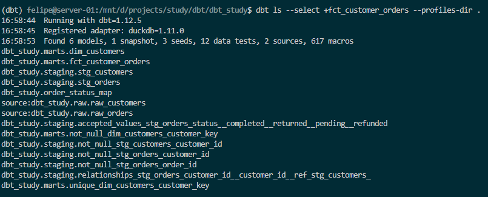
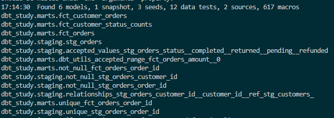
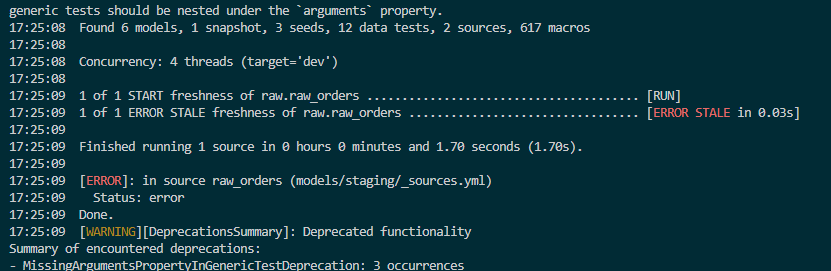
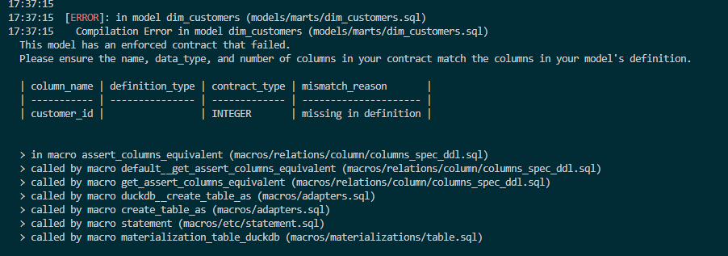
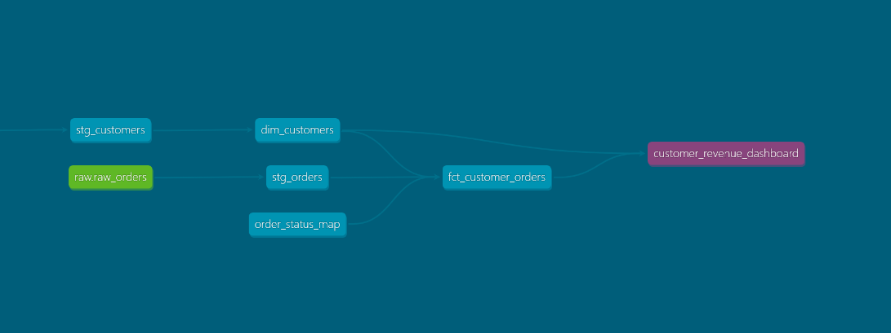

## Start

- Selectors

You can run dbt commnads with 

| Syntax	| Meaning |
| --- | --- |
|model	| just that model |
| +model	| the model and everything upstream (its ancestors) |
| model+	| the model and everything downstream (its descendants) |
| 1+model	| the model and its direct parents only (N degrees) |
| tag:x, path:models/staging, source:raw+	| by tag, folder, or source |
| a b (space)	| union (a or b) |
| a,b (comma)	| intersection (a and b) |
| --exclude	| subtract from the selection |

Changed the ***dbt_projects.yml*** models section
```
models:
  dbt_study:
    staging:
      +materialized: view
      +tags: ['staging']
    marts:
      +materialized: table
      +tags: ['marts']
```

So the selectors can be applied like 
```
dbt ls --select fct_orders+ --profiles-dir .
dbt ls --select +fct_customer_orders --profiles-dir .
dbt ls --select 1+stg_orders --profiles-dir .
dbt ls --select "source:raw+" --profiles-dir .
dbt ls --select "tag:marts,resource_type:model" --profiles-dir .
dbt ls --select stg_orders fct_orders --profiles-dir .
dbt ls --select "tag:marts" --exclude fct_orders --profiles-dir .
```

Example



### Environment with targets
There can be multiple targets pointing to the models, and they can be defined in the ***profiles.yml*** file, for example as ***dev*** / ***prod*** distinctions

In Databricks analogy, it's similar to Unity Catalog schemas, which can be mapped to
- prod.<stableName>
- dev.<stableName>

Created new profiles with 
```
cat > profiles.yml << 'EOF'
dbt_study:
  target: dev
  outputs:
    dev:
      type: duckdb
      path: dbt_study.duckdb
      threads: 4
    prod:
      type: duckdb
      path: dbt_study.duckdb
      schema: prod
      threads: 4
    ci:
      type: duckdb
      path: dbt_study.duckdb
      schema: "{{ env_var('CI_SCHEMA', 'ci') }}"
      threads: 4
EOF
```

### Build the prod target and save its manifest
There's a file under ***target*** folder, called ***manifest.json*** with the parsed description of the project.
So it can be run with 
```
dbt build --target prod --profiles-dir .
```

This generated the ***manifest.json*** file and it will be moved to get a copy with

```
mkdir -p prod-artifacts
cp target/manifest.json prod-artifacts/
echo "prod-artifacts/" >> .gitignore
python -c "import duckdb; print(duckdb.connect('dbt_study.duckdb').sql(\"select table_schema, table_name from information_schema.tables where table_schema='prod' order by 2\").df())"
```

### Modify CI with ***state:modified+*** and ***--defer***

This will only apply to changes in the manifest, so the selector can be used to whenever some change in code is done, only the selected references are rebuilt.

Change made
```
cat > models/staging/stg_orders.sql << 'EOF'
select
    id as order_id,
    customer_id,
    lower(status) as status,
    {{ cents_to_currency('amount_cents') }} as amount,
    cast(ordered_at as timestamp) as ordered_at,
    cast(updated_at as timestamp) as updated_at
from {{ source('raw', 'raw_orders') }}
EOF

dbt ls --select state:modified+ --state prod-artifacts --profiles-dir .
```

So only downstream sources were affected, not needing to rebuild all upstream to test out and compute again



### Source freshness
It checks how fresh the source is, taking max(field) from the raw table and compares it with now

Changing sources in staging with 
```
cat > models/staging/_sources.yml << 'EOF'
version: 2

sources:
  - name: raw
    schema: main
    tables:
      - name: raw_customers
      - name: raw_orders
        loaded_at_field: updated_at
        freshness:
          warn_after: {count: 12, period: hour}
          error_after: {count: 24, period: hour}
EOF

dbt source freshness --profiles-dir .
```

It only errored out with


since the data is from 2024 and is way past the threshold

### Model contracts
Contracts test the declared schema of a model (types and columns) and tests validate the contents (the actual data)

It matters since a naming change can produce downstream errors that depend on it, so it breaks the build instead, not allowing the PR for example to pass.

So, let's say the following contract is in place
```
cat > models/marts/_marts.yml << 'EOF'
version: 2

models:
  - name: fct_orders
    columns:
      - name: order_id
        data_tests:
          - unique
          - not_null
      - name: amount
        data_tests:
          - dbt_utils.accepted_range:
              min_value: 0

  - name: dim_customers
    config:
      contract:
        enforced: true
    columns:
      - name: customer_key
        data_type: varchar
        data_tests: [unique, not_null]
      - name: customer_id
        data_type: integer
      - name: full_name
        data_type: varchar
      - name: email
        data_type: varchar
      - name: created_at
        data_type: date
EOF

dbt build --select dim_customers --profiles-dir .
```

To test it out, will remove ***email*** from the ***dim_customers.sql*** to verify the build error

```
select
    {{ dbt_utils.generate_surrogate_key(['customer_id']) }} as customer_key,
    customer_id,
    first_name || ' ' || last_name as full_name,
    created_at
from {{ ref('stg_customers') }}
```

produces the error



You can define exposures that let outside tools be mapped inside dbt, for instance, BI tools that references some of the models inside, so

```
cat > models/marts/_exposures.yml << 'EOF'
version: 2

exposures:
  - name: customer_revenue_dashboard
    type: dashboard
    maturity: medium
    owner:
      name: Analytics Team
      email: analytics@example.com
    depends_on:
      - ref('fct_customer_orders')
      - ref('dim_customers')
EOF

dbt docs generate --profiles-dir .
```

And the lineage graph now shows the new leaf, demonstrating external depedency from the exposure



### CI workflow
You can do a lot of linting, parsing and builds in the PR, letting code be merged only when those steps are okay.

For testing purposes, some SQL syntax will be used through Python library, to provide automated way of formatting the queries.

```
pip install sqlfluff
cat > .sqlfluff << 'EOF'
[sqlfluff]
dialect = duckdb
templater = jinja
exclude_rules = ST06, LT05

[sqlfluff:templater:jinja]
apply_dbt_builtins = True
EOF

sqlfluff lint models macros
```

And that can be run against Githubs runners

```
pip freeze | grep -iE "^(dbt|duckdb|sqlfluff)" > requirements.txt

mkdir -p ci .github/workflows
cat > ci/profiles.yml << 'EOF'
dbt_study:
  target: ci
  outputs:
    ci:
      type: duckdb
      path: ci.duckdb
      threads: 4
EOF

printf '!ci/profiles.yml\nci.duckdb\n' >> .gitignore

cat > .github/workflows/dbt_ci.yml << 'EOF'
name: dbt CI

on:
  pull_request:
    branches: [main]

jobs:
  build:
    runs-on: ubuntu-latest
    steps:
      - uses: actions/checkout@v4

      - uses: actions/setup-python@v5
        with:
          python-version: "3.12"
          cache: pip

      - run: pip install -r requirements.txt

      - run: dbt deps --profiles-dir ci
      - run: dbt parse --profiles-dir ci          # fails fast on broken refs
      - run: sqlfluff lint models macros          # style gate
      - run: dbt seed --profiles-dir ci           # simulate the raw layer
      - run: dbt build --profiles-dir ci          # models + tests in DAG order
EOF
```

Checkpoints
1. What do +model, model+, 1+model, a space, and a comma do in a selector?
- It changes the selector and what it means that to check +model (the current model and ancestors), model+ (current + successors), 1+model (upstream directly 1 level above ancestor), a space (gets the union of the models), comma (the union)
2. What does state:modified+ compare against, and how is that state different from incremental-model state (Day 2 Q6)?
- It compares against the manifest, the incremental-model changes the the data in the table, not manifest as far as I understood it
3. What does --defer do to a ref() that isn’t selected? Why does this save cost?
- It will build only what's changed in the code, so it doesn't recompute all of the models again, saving compute costs on computing for instance, a mart that changed a filter, it doesn't need to recompute all of the upstream dependencies
4. Why must dev, CI, and prod build into different schemas? What breaks if CI writes to prod?
- Its mainly differentiating the workspaces, dev should always write on dev schema, prod on its own and so on. Let's say you didn't do that and ran your test against the actual models, it would overwrite a "prod" table, even though it was just a test
5. Contract vs test: when does each run, and what does each protect?
- Tests will run against the computed values, the data itself or the values contained in the tables. Data contracts will run in the build process, as to catch errors in the overall structure (schemas, mostly column types and names) of the models. If it can't build at all, somethings off and that can't be let to go to prod. Those are different aspects of the tables, one measuring the contents, other the structure
6. What does source freshness measure, and why isn’t unique or not_null a substitute?
- It gets how the sources are updated, not that the constraints (unique, not_null) are valid. Example a table can pass those constraints and still have out of date data, as is in our case, data from 2024 has  freshness problems, but the constraints against it are valid, giving valid checks on tests, but not having current data.
7. If you migrated fct_orders to Databricks, which configs would you change? How would you map dev, CI, and prod to Unity Catalog?
- We could update the ***profiles.yml*** file and add to the databricks profile the hostname, user_id and other configs to be able to access the Catalog somehow, for it to be hosted there, so the models could be identified through options like file_format being delta, liquid_clustering configs and tblproperties.

### Claude corrections:
1. Q1: selectors (one error)

Five of the six pieces are right:

+model is the model and its ancestors.
model+ is the model and its descendants.
1+model is the model and its direct parents only, one level up.
A space is a union, which you got right.
A comma is an intersection, not a union. You wrote it as a union.

Remember it as space = OR, comma = AND. Check it with dbt ls:

bash
dbt ls --select "tag:staging fct_orders" --profiles-dir .    # all staging models, plus fct_orders
dbt ls --select "tag:staging,fct_orders" --profiles-dir .    # nothing: no model is both

Interviewers like asking this one, because mixing up union and intersection means a CI job selects the wrong set of models.

### Q2: state:modified+ (correct)

It compares your branch against a saved manifest, which is what a prior production run recorded. Incremental state is the max watermark in the target table. They are unrelated. To be precise, the comparison is on file checksums and configs, not on data, which is why a comment change counts as modified. You were going to test that in the stretch section.

### Q3: --defer (mixes up two mechanisms)

You described what state:modified+ does, which is choosing what to build. --defer does something different and complementary:

--select state:modified+ decides what gets built.
--defer --state <dir> decides where ref() points for the models that are not built.

Say CI rebuilds only fct_customer_orders. It still has to read dim_customers and stg_orders, but those weren’t rebuilt, so they don’t exist in your CI schema. Without defer, the build fails on missing tables, or you’re forced to build all ancestors with +. With defer, dbt points those refs at the production tables recorded in the manifest. That is the saving: you test your change against real prod data without recomputing anything upstream.

Your example (a mart that changed a filter doesn’t need its upstream recomputed) is the right outcome. The mechanism is defer.

Defer needs those prod objects to exist and be reasonably current.

### Q4: separate schemas (correct, add more reasons)

Overwriting a prod table is the main risk. Other reasons, which come up in interviews:

Consumers read prod. Dashboards would show half-built or test data during CI.
Concurrency. Two developers or two PRs writing to the same schema overwrite each other, so use per-developer (dbt_alice) and per-PR (pr_123) schemas.
Permissions. The CI service principal shouldn’t have write access to prod at all, so a bug can’t touch it.
Cleanup. Per-PR schemas must be dropped on PR close, or they accumulate.
### Q5: contract vs test (correct)

Add the ordering detail: a contract is checked at build time, before the table is replaced, so a violation leaves the existing table untouched. Tests run after the table is built. With dbt build, a failed test then blocks downstream models. Contracts guard the shape, and tests guard the content.

### Q6: freshness (correct)

Your example is the right one: the table passes every constraint and is still stale. Two additions:

The loaded_at_field should be a load or ingestion time, not a business timestamp. Our updated_at is a business timestamp, so freshness here is only a stand-in. In a real project you’d use something like _ingested_at or _fivetran_synced.
Freshness is a separate command (dbt source freshness), not part of dbt build. You run it first so you can skip the build when the source is stale.
### Q7: migrating to Databricks (half answered)

You covered the model configs (delta, liquid clustering, tblproperties), but not the environment mapping the question asked for, and a few details need correcting.

Profile: the Databricks adapter doesn’t have a user_id field. You need host, http_path (the SQL warehouse), catalog, schema, and an auth method. Dev uses a personal token. Prod uses a service principal (OAuth M2M), so no jobs run as a person. Credentials come from env_var(), never from Git.

Model configs to change:

incremental_strategy: delete+insert → merge, which generates a real Delta MERGE INTO.
file_format='delta', plus liquid_clustered_by instead of partitioning (unless the table is huge and date-bound, which favors insert_overwrite).
tblproperties for table settings, and persist_docs to push YAML descriptions into Unity Catalog comments.

Mapping environments to Unity Catalog:

Environment	Catalog	Schema	Identity
dev	dev_catalog	dbt_<user>	personal token
CI	dev_catalog or ci_catalog	pr_<number>, dropped on close	CI service principal
prod	prod_catalog	analytics	prod service principal